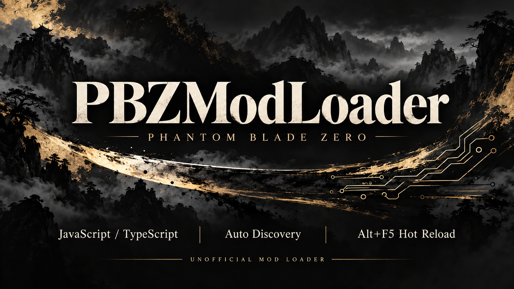

**The Chinese version is further down. / 中文版在下方：[跳转到中文版](#chinese)**

---

[](https://github.com/KintaroModding/phantombladezero_pbzmodloader/releases)

# PBZModLoader

A mod loader for **Phantom Blade Zero**. It runs JavaScript mods in the game's own script engine, and it lets pak mods change the game's scripts again. A player installs one DLL and its start file. You need no UE4SS, no Node.js and no compiler.

This is an official fork of [PBZModLoader](https://github.com/zoneoflkf/PBZModLoader) by LKF, under GPL-3.0. Please report problems with this fork here, not to the author. [FORK.md](FORK.md) lists every change.

**Download:** [releases](https://github.com/KintaroModding/phantombladezero_pbzmodloader/releases). The player needs `PBZModLoader-<version>-win64.zip`, and mod authors also need `PBZModLoader-<version>-developer.zip`.

## What it does

- **Loads mods by itself.** Every folder in `ProjectPBZ/PBZModLoader/mods/` with a `main.js` is a mod. You need no configuration.
- **Keeps pak mods working.** Since the game update of 2026-11-04, the game refuses changed game scripts. The loader allows them again, so script pak mods in `~mods` run without another tool.
- **Reloads while you play.** Alt+F5 reloads JavaScript mods that support hot reload, without a game restart. It does not reload pak or UE4SS mods.
- **Runs beside Mods Menu.** With Mods Menu 0.9.0 or later in the game, both run: Mods Menu starts its mods first, then this loader starts the mods in its own folder.
- **Skips unsupported builds.** If the loader cannot match a game build, it skips initialization. Mods that depend on the loader may not work.

## What it puts in the game

| File | Note |
|---|---|
| `platform/steam/version.dll` (or `platform/wegame/`) | The whole loader. Its scripts are inside this file. |
| `ProjectPBZ/Content/JavaScript/PBZModLoader/bootstrap.js` | The start file, 32 KiB. The DLL puts its scripts in place of this file's content, in memory. Do not edit or delete it. |
| `ProjectPBZ/PBZModLoader/LICENSES.txt` | The license texts. |
| `ProjectPBZ/PBZModLoader/mods/` | Your mods. |
| `ProjectPBZ/PBZModLoader/mods.ini` | Optional. The loader does not create it automatically. |
| `ProjectPBZ/PBZModLoader/loader.log` | The log. It starts new with each game start and stops at about 8 MB. |

The loader writes nothing else: no copies of mods, no caches, no generated scripts.

## Install

**The easiest way:** install it with one click in the mod manager [UE MM](https://github.com/KintaroModding/uemodmanager).

To install by hand:

1. Close the game and open its install folder, the one that holds `ProjectPBZ`.
2. Look next to the real game exe (`platform/steam` or `platform/wegame`). If another tool already has a `version.dll` there, do not overwrite it: use one of the DLLs in `alternative-entries/` instead.
3. For the default entry, copy `ProjectPBZ/` into the install folder, and `version.dll` from the matching platform folder next to the game exe. If `version.dll` belongs to another tool, copy only `ProjectPBZ/` and place one selected alternative DLL beside the game exe. Keep its original name. In that case, do not copy the packaged `version.dll` or the whole `alternative-entries/` folder.
4. Start the game from its platform as usual.

The [install guide](runtime/PBZModLoader-Install-Guide.txt) in the zip explains the alternative entries, updates and removal. Mod managers: see [docs/MOD-MANAGER.md](docs/MOD-MANAGER.md).

**Updating from version 2.0.x:** close the game, replace the DLL and `LICENSES.txt`, and add the start file. Keep `mods/` and `mods.ini`.

**Updating from version 1.0.x:** do the same. Then remove `manager.js`, `generated-config.js`, `generated-mods/` and `generated-reloads/` from `ProjectPBZ/Content/JavaScript/PBZModLoader/`, and `ProjectPBZ/PBZModLoader/compiler/`, `ProjectPBZ/PBZModLoader/evidence/` and `ProjectPBZ/PBZModLoader/TOOLCHAIN-LICENSE.txt`. The new start file replaces the old `bootstrap.js` in that folder. Keep `mods/` and `mods.ini`.

## Settings

Without `mods.ini`, every mod loads. Create `ProjectPBZ/PBZModLoader/mods.ini` only to change something:

```ini
[Loader]
Version=1
; 0 turns the whole loader off.
Enabled=1
; 0 refuses pak mods that change game scripts.
AllowScriptPaks=1

[Mods]
; 0 turns one mod off.
my-mod=0
```

## For mod authors

A mod is a folder such as `ProjectPBZ/PBZModLoader/mods/my-mod/` with a `main.js`. The folder name is the mod's ID: English letters, digits, `_` and `-`.

- **Ship JavaScript.** The loader compiles nothing. A mod with only `main.ts` does not run, and `loader.log` says so. Write TypeScript with the [template](templates/ts-mod/README.md) and the [game API types](sdk/README.md) from the developer zip, then ship the compiled result.
- **Modules work as in the game.** Use `require('./helper')` for your own files, JSON included, and `require('ue')`, `require('puerts')` or `require('Library/TsHelper')` for the game's.
- **Export `stop()`.** The loader starts a mod by running `main.js`. Before a reload it calls and awaits `stop()`, so clear your timers and unsubscribe from events there. If `stop()` is missing or fails, the existing instance is retained and its replacement is not loaded.
- **Read the log.** Lines from `console.log` that start with `[PBZMOD]` reach `loader.log`, and so do the game's warnings and errors.

## How it works

1. `version.dll` sits next to the exe, so Windows loads it at the game's start. It forwards calls to the corresponding Windows system DLL, and it runs once before the game's own entry point.
2. It finds the game's code by its bytes, not by fixed addresses. Each match must be unique, or it skips the mods and changes nothing.
3. The game asks for its first script on disk. The loader names its start file, `PBZModLoader/bootstrap`, and replaces that file's bytes in memory, at the game's script check. So the start file only gives the scripts a name and room: the scripts themselves come from the DLL. They start the game's `MainStart`, then the mods. Without the start file, the loader names a game script that nothing else uses instead.
4. Mods load directly from their folder through the game's module system. The check accepts a mod's file only if it matches the file on disk.
5. On a reload, the loader spells its folder's path in a different case. Windows sees the same folder, but the game's module cache sees new modules, so nothing is copied.

## Compatibility

- **Tested in the game:** Steam build 26367565 (`CL-302256_JKS-17280`), with UE4SS and its mods, with pak mods that change game scripts, and with Mods Menu 0.9.0 and its mods.
- **WeGame:** the package holds the same DLL. The original author tested an earlier build there; this fork has not.
- **Game updates:** updates may require a loader update even though it searches for code signatures. If initialization fails, read the reason after `MODs skipped` in `loader.log`. Mods that depend on the loader may not work.
- **Mods Menu:** install it by hand from its own page. Version 0.9.0 or later runs beside this loader and needs its start file. Without the start file, Mods Menu stays off. Older versions conflict with this loader. Mods Menu uses `hid.dll`, so do not use this loader's spare `hid` entry next to it.
- **Other script loaders:** do not combine it with other loaders that change the same check. UE4SS C++ BYPASS runs next to it, but it is no longer needed.

## Known limits

- After a reload, an old mod copy that was not stopped and calls `require` late reads the file as it is now, because no old copy exists.
- A mod that fails at its start is not tried again until the next game start.
- After about 4000 reloads in one game run, restart the game.
- Builds before the update of 2026-11-04 are not supported.
- If this loader skips its start, for example on a build it does not support, Mods Menu runs alone. It then starts the mods in `mods/` only when a `mods.ini` exists.

## Build from source

You need [llvm-mingw](https://github.com/mstorsjo/llvm-mingw) `20261020` (UCRT, x86_64), PowerShell 7 and Node.js. The scripts do not run in Windows PowerShell 5.1.

```powershell
npm ci
.\build.ps1 -Compiler C:\path\to\llvm-mingw\bin\clang++.exe -Test -GameExe C:\path\to\PBZ.exe
npm test
.\package.ps1 -Version 2.1.0
```

`-GameExe` is optional, and it only reads the file. The zips land in `releases/`. Offline tests do not replace a test in the game: `tests/game-fixture/loader-check` is a mod for that, and `tests/verify-run.ps1` checks a log.

| Folder | Content |
|---|---|
| `src/` | The DLL's source, and `script-bootstrap.js` and `script-manager.js`, which are built into it. `scripts/embed-script.cjs` makes the start file. |
| `runtime/` | The install guide and license texts for the package |
| `templates/ts-mod/` | A minimal TypeScript mod |
| `sdk/` | TypeScript types for the game's API |
| `tests/`, `scripts/` | Tests and developer tools |
| `docs/` | The contract for mod managers, and images |

## Credits and license

PBZModLoader was created by [LKF](https://github.com/zoneoflkf/PBZModLoader), who also made the cover image. The original releases are on [Nexus Mods](https://www.nexusmods.com/phantombladezero/mods/113). This fork is maintained by KintaroModding.

GNU General Public License, version 3: see [LICENSE](LICENSE). The DLLs include the LLVM and MinGW-w64 runtimes under their own licenses: see `runtime/ProjectPBZ/PBZModLoader/`.

---

<a id="chinese"></a>

# PBZModLoader（中文）

《影之刃零》（Phantom Blade Zero）的 MOD 加载器。它在游戏自身的脚本引擎中运行 JavaScript MOD，并重新支持修改游戏脚本的 pak MOD。玩家只需安装一个 DLL 及其启动文件，无需 UE4SS、Node.js 或编译器。

这是 LKF 的 [PBZModLoader](https://github.com/zoneoflkf/PBZModLoader) 的官方分支，遵循 GPL-3.0。本分支的问题请在此反馈，不要反馈给原作者。[FORK.md](FORK.md) 列出了所有改动。

**下载：**[releases](https://github.com/KintaroModding/phantombladezero_pbzmodloader/releases)。玩家需要 `PBZModLoader-<版本>-win64.zip`，MOD 作者还需要 `PBZModLoader-<版本>-developer.zip`。

## 功能

- **自动加载 MOD。** `ProjectPBZ/PBZModLoader/mods/` 中每个含 `main.js` 的文件夹都是一个 MOD，无需配置。
- **让 pak MOD 继续可用。** 自 2026-11-04 游戏更新起，游戏会拒绝被修改的游戏脚本。加载器重新允许它们，因此 `~mods` 中的脚本 pak MOD 无需其他工具即可运行。
- **游戏中重载。** 按 Alt+F5 可重载支持热重载的 JavaScript MOD，无需重启游戏。此操作不会重载 pak MOD 或 UE4SS MOD。
- **可与 Mods Menu 同时运行。** 游戏中装有 Mods Menu 0.9.0 或更高版本时，两者都会运行：Mods Menu 先启动它的 MOD，然后本加载器启动自己文件夹中的 MOD。
- **不支持时跳过初始化。** 如果加载器无法匹配某个游戏版本，它会跳过初始化。依赖此加载器的 MOD 可能无法正常运行。

## 安装到游戏中的内容

| 文件 | 说明 |
|---|---|
| `platform/steam/version.dll`（或 `platform/wegame/`） | 整个加载器，脚本已内置其中。 |
| `ProjectPBZ/Content/JavaScript/PBZModLoader/bootstrap.js` | 启动文件，32 KiB。DLL 会在内存中用自己的脚本替换此文件的内容。请勿修改或删除。 |
| `ProjectPBZ/PBZModLoader/LICENSES.txt` | 许可证文本。 |
| `ProjectPBZ/PBZModLoader/mods/` | 你的 MOD。 |
| `ProjectPBZ/PBZModLoader/mods.ini` | 可选。加载器不会自动创建此文件。 |
| `ProjectPBZ/PBZModLoader/loader.log` | 日志。每次启动游戏时重新生成，约 8 MB 后停止写入。 |

加载器不会写入其他内容：没有 MOD 副本、没有缓存、没有生成的脚本。

## 安装

**最简单的方式：** 在 MOD 管理器 [UE MM](https://github.com/KintaroModding/uemodmanager) 中一键安装。

手动安装步骤如下：

1. 退出游戏，打开游戏安装目录（能看到 `ProjectPBZ` 的位置）。
2. 检查实际游戏 EXE 旁（`platform/steam` 或 `platform/wegame`）。如果其他工具已有 `version.dll`，请勿覆盖，改用 `alternative-entries/` 中的一个 DLL。
3. 使用默认入口时，将 `ProjectPBZ/` 复制到游戏安装目录，并将对应平台文件夹中的 `version.dll` 放到游戏 EXE 旁。如果 `version.dll` 属于其他工具，则只复制 `ProjectPBZ/`，并将一个选定的备用 DLL 放到游戏 EXE 旁，保持原文件名。此时不要复制压缩包中的 `version.dll`，也不要复制整个 `alternative-entries/` 文件夹。
4. 从原游戏平台启动游戏。

压缩包内的[安装说明](runtime/PBZModLoader-Install-Guide.txt)介绍了备用入口、更新和卸载。MOD 管理器请参阅 [docs/MOD-MANAGER.md](docs/MOD-MANAGER.md)。

**从 2.0.x 更新：** 退出游戏，替换 DLL 和 `LICENSES.txt`，并添加启动文件。保留 `mods/` 和 `mods.ini`。

**从 1.0.x 更新：** 按上述步骤操作，然后删除 `ProjectPBZ/Content/JavaScript/PBZModLoader/` 中的 `manager.js`、`generated-config.js`、`generated-mods/` 和 `generated-reloads/`，以及 `ProjectPBZ/PBZModLoader/compiler/`、`ProjectPBZ/PBZModLoader/evidence/` 和 `ProjectPBZ/PBZModLoader/TOOLCHAIN-LICENSE.txt`。新的启动文件会替换该文件夹中旧的 `bootstrap.js`。保留 `mods/` 和 `mods.ini`。

## 设置

没有 `mods.ini` 时，所有 MOD 都会加载。只有需要更改时才创建 `ProjectPBZ/PBZModLoader/mods.ini`：

```ini
[Loader]
Version=1
; 0 表示关闭整个加载器。
Enabled=1
; 0 表示拒绝修改游戏脚本的 pak MOD。
AllowScriptPaks=1

[Mods]
; 0 表示关闭单个 MOD。
my-mod=0
```

## MOD 作者

MOD 是一个文件夹，例如 `ProjectPBZ/PBZModLoader/mods/my-mod/`，其中包含 `main.js`。文件夹名即 MOD ID：英文字母、数字、`_` 和 `-`。

- **发布 JavaScript。** 加载器不编译任何内容。只有 `main.ts` 的 MOD 不会运行，`loader.log` 会说明原因。请用开发包中的[模板](templates/ts-mod/README.md)和[游戏 API 类型](sdk/README.md)编写 TypeScript，然后发布编译结果。
- **模块与游戏中相同。** 用 `require('./helper')` 引用自己的文件（包括 JSON），用 `require('ue')`、`require('puerts')` 或 `require('Library/TsHelper')` 引用游戏模块。
- **导出 `stop()`。** 加载器通过运行 `main.js` 启动 MOD。重载前会调用并等待 `stop()`，请在其中清除定时器并取消事件订阅。如果缺少 `stop()` 或清理失败，将保留现有实例，不加载新版本。
- **查看日志。** 以 `[PBZMOD]` 开头的 `console.log` 内容会写入 `loader.log`，游戏的警告和错误也会写入。

## 工作原理

1. `version.dll` 位于 EXE 旁，因此 Windows 在游戏启动时加载它。它将对应 Windows DLL 的函数调用转发给系统原版 DLL，并在游戏自身入口点之前运行一次。
2. 它按字节查找游戏代码，不使用固定地址。每项匹配必须唯一，否则跳过 MOD 且不做任何更改。
3. 游戏从磁盘查找第一个脚本。加载器指定其启动文件 `PBZModLoader/bootstrap`，并在游戏的脚本校验处替换该文件在内存中的字节。因此启动文件只为脚本提供名称和空间，脚本本身来自 DLL。这些脚本先启动游戏的 `MainStart`，再加载 MOD。没有启动文件时，加载器改为指定一个没有其他用途的游戏脚本。
4. MOD 通过游戏的模块系统直接从其文件夹加载。只有与磁盘文件一致的 MOD 文件才能通过校验。
5. 重载时，加载器用不同的大小写拼写其文件夹路径。Windows 视为同一文件夹，而游戏的模块缓存视为新模块，因此无需复制任何内容。

## 兼容性

- **已在游戏中测试：** Steam 构建 26367565（`CL-302256_JKS-17280`），包括与 UE4SS 及其 MOD 同时使用、修改游戏脚本的 pak MOD，以及与 Mods Menu 0.9.0 及其 MOD 同时使用。
- **WeGame：** 压缩包内是同一个 DLL。原作者曾在较早版本上测试，本分支尚未测试。
- **游戏更新：** 即使加载器通过代码特征进行匹配，游戏更新后仍可能需要更新加载器。如果初始化失败，请查看 `loader.log` 中 `MODs skipped` 后的具体原因。依赖此加载器的 MOD 可能无法正常运行。
- **Mods Menu：** 请从其页面手动安装。0.9.0 或更高版本可与本加载器同时运行，并需要本加载器的启动文件。没有启动文件时，Mods Menu 不会启动。更早的版本会与本加载器冲突。Mods Menu 使用 `hid.dll`，因此请勿同时使用本加载器的备用 `hid` 入口。
- **其他脚本加载器：** 请勿与其他修改同一校验的加载器同时使用。UE4SS C++ BYPASS 可以同时运行，但已不再需要。

## 已知限制

- 重载后，未被停止且延迟调用 `require` 的旧实例读取的是文件当前的内容，因为没有旧副本。
- 启动时失败的 MOD 在下次启动游戏前不会重试。
- 一次游戏运行中约 4000 次重载后，请重启游戏。
- 不支持 2026-11-04 更新之前的版本。
- 如果本加载器跳过启动（例如在不支持的版本上），Mods Menu 会单独运行。此时只有存在 `mods.ini` 时，它才会启动 `mods/` 中的 MOD。

## 从源码构建

需要 [llvm-mingw](https://github.com/mstorsjo/llvm-mingw) `20261020`（UCRT、x86_64）、PowerShell 7 和 Node.js。这些脚本无法在 Windows PowerShell 5.1 中运行。

```powershell
npm ci
.\build.ps1 -Compiler C:\path\to\llvm-mingw\bin\clang++.exe -Test -GameExe C:\path\to\PBZ.exe
npm test
.\package.ps1 -Version 2.1.0
```

`-GameExe` 是可选的，只读取该文件。压缩包生成在 `releases/`。离线测试不能代替游戏内测试：`tests/game-fixture/loader-check` 是用于游戏内测试的 MOD，`tests/verify-run.ps1` 用于检查日志。

| 文件夹 | 内容 |
|---|---|
| `src/` | DLL 源码，以及内置其中的 `script-bootstrap.js` 和 `script-manager.js`。启动文件由 `scripts/embed-script.cjs` 生成。 |
| `runtime/` | 压缩包中的安装说明和许可证文本 |
| `templates/ts-mod/` | 最小的 TypeScript MOD |
| `sdk/` | 游戏 API 的 TypeScript 类型 |
| `tests/`、`scripts/` | 测试和开发工具 |
| `docs/` | MOD 管理器约定和图片 |

## 致谢与许可证

PBZModLoader 由 [LKF](https://github.com/zoneoflkf/PBZModLoader) 创建，封面图片也由其制作。原版发布在 [Nexus Mods](https://www.nexusmods.com/phantombladezero/mods/113)。本分支由 KintaroModding 维护。

GNU 通用公共许可证第 3 版：见 [LICENSE](LICENSE)。DLL 包含 LLVM 和 MinGW-w64 运行库，它们使用各自的许可证：见 `runtime/ProjectPBZ/PBZModLoader/`。
